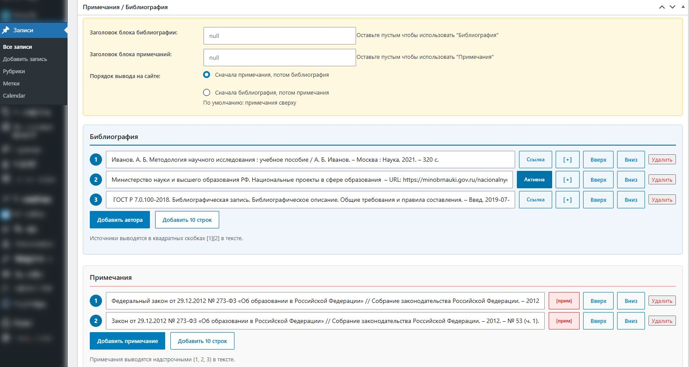
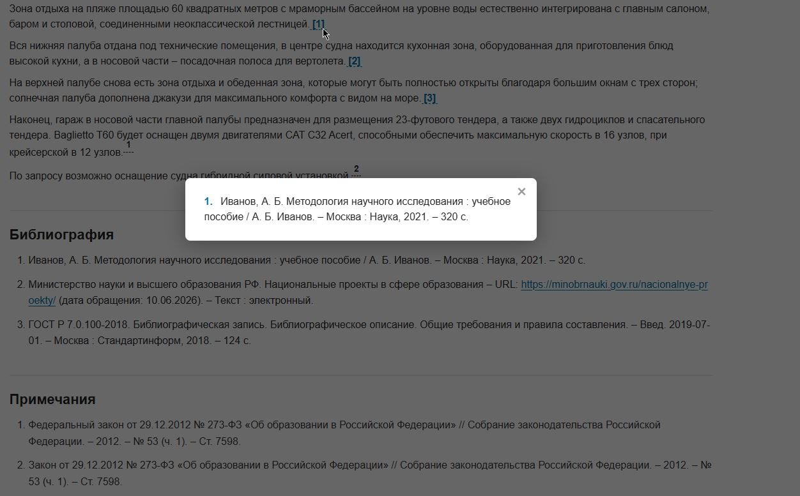
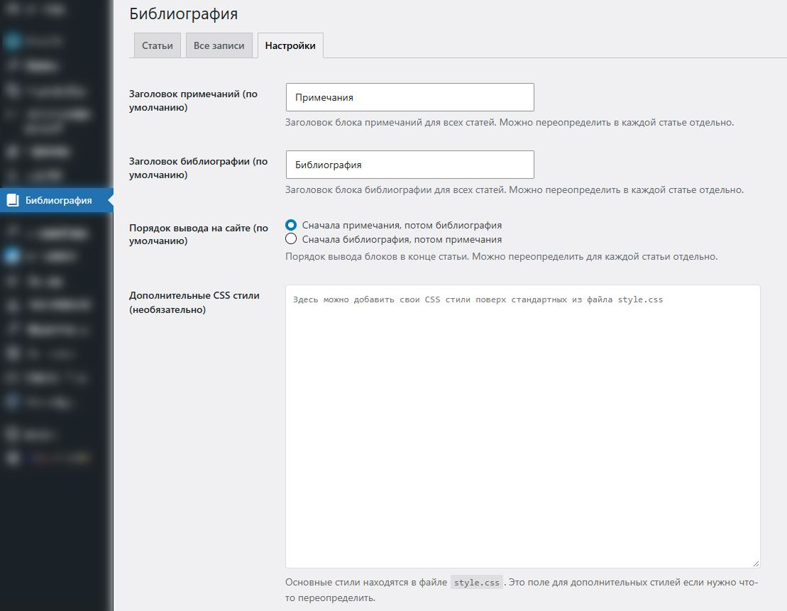

# Bibliography Pro

  

## Плагин для управления библиографией и примечаниями в WordPress

**Bibliography Pro** — это мощный инструмент для научных журналов, академических сайтов и блогов, позволяющий легко добавлять список литературы и сноски к статьям.

[Описание](#о-плагине) · [Возможности](#возможности) · [Установка](#установка) · [Использование](#использование) · [Changelog](#changelog) · [Поддержка](#поддержка)

---

## О плагине

Плагин решает проблему ручного оформления ссылок на источники и примечаний. Он автоматически нумерует их, создает красивые всплывающие окна при клике и позволяет гибко настраивать внешний вид без знания CSS.

### Ключевые особенности:
*   **Два типа данных:** Библиография (список литературы) и Примечания (сноски).
*   **Удобная вставка:** Кнопки `[+]` и `[прим]` прямо в редакторе статьи.
*   **Гибкий порядок:** Можно менять порядок вывода блоков (сначала примечания или сначала литература).
*   **Совместимость:** Работает с Классическим редактором и Gutenberg.

---

## Возможности

### 📚 Библиография (Список литературы)
| Функция | Описание |
| :--- | :--- |
| **Автоматическая нумерация** | Источники нумеруются автоматически ([1], [2], [3]). |
| **Всплывающие окна** | При клике на номер в тексте открывается красивое окно с полным описанием источника. |
| **Активные ссылки** | Возможность сделать URL внутри описания источника кликабельными одной кнопкой. |
| **Сортировка** | Кнопки "Вверх/Вниз" для быстрого изменения порядка источников. |

### 📝 Примечания (Сноски)
| Функция | Описание |
| :--- | :--- |
| **Надстрочные цифры** | Вставка цифр (¹, ², ³) прямо в текст статьи. |
| **Отдельная нумерация** | Примечания нумеруются независимо от библиографии. |
| **Быстрая вставка** | Кнопка `[прим]` в админке для мгновенной вставки сноски в место курсора. |

### ⚙️ Настройки и Админка
| Функция | Описание |
| :--- | :--- |
| **Индивидуальные заголовки** | Можно задать уникальные названия блоков для каждой статьи отдельно. |
| **Порядок вывода** | Глобальная настройка: что выводить первым — примечания или библиографию. |
| **Кастомный CSS** | Поле для ввода своих стилей поверх стандартных. |
| **Управление статьями** | Отдельная вкладка в админке со списком всех статей, где есть библиография. |

---

## Скриншоты

  
   <em>Блок управления библиографией и примечаниями в редакторе WordPress</em>

  
   <em>Пример отображения плагина библиографии на сайте</em>

  
   <em>Глобальные настройки плагина</em>

---

## Установка

### Способ 1: Автоматическая установка
1. Скачайте ZIP-архив плагина.
2. Перейдите в админке WordPress: **Плагины → Добавить новый → Загрузить плагин**.
3. Выберите файл `bibliography-pro.zip` и нажмите **Установить**.
4. Активируйте плагин.

### Способ 2: Через FTP / Git
1. Клонируйте репозиторий или распакуйте архив.
2. Загрузите папку `bibliography-pro` в директорию `/wp-content/plugins/`.
3. Активируйте плагин в разделе **Плагины**.

---

## Использование

1. Откройте любую статью для редактирования.
2. Прокрутите вниз до блока **"Примечания / Библиография"**.
3. Добавьте источники литературы или текст примечаний.
4. Чтобы вставить ссылку в текст:
   - Поставьте курсор в нужное место текста.
   - Нажмите кнопку **[+]** (для библиографии) или **[прим]** (для сносок).
5. Сохраните статью. На сайте ссылки превратятся в интерактивные элементы.

---

## Changelog

### 1.3.0
*   ✨ Добавлена настройка порядка вывода (сначала примечания или библиография).
*   ✨ Перенесены заголовки внутрь секций для удобства.
*   🚀 Добавлены кнопки "Добавить 10 строк" для быстрого заполнения.
*   🎨 Убраны эмодзи из интерфейса админки.
*   🛠 Улучшена работа в админке.

### 1.2.0
*   ✨ Добавлены примечания (надстрочные цифры).
*   ✨ Индивидуальные заголовки для каждой статьи.
*   🎨 Все стили перенесены в отдельный файл `style.css`.
*   ⚡ Оптимизирован код.

### 1.1.0
*   🐛 Исправлена работа с ревизиями записей.
*   ✨ Добавлена поддержка запланированных статей.
*   🔗 Добавлена ссылка "Открыть" в списке статей в админке.

### 1.0.0
*   🎉 Первый релиз.
*   ✨ Библиография с ссылками в тексте.
*   ✨ Всплывающие окна при клике.
*   ✨ Удобное управление в админке.

---

## Поддержка

Если у вас возникли вопросы или предложения по улучшению плагина:

*   **GitHub Issues:** [Сообщить об ошибке](https://github.com/elizarov-n906/bibliography-pro/issues)
*   **Email:** [zaplata_ru@mail.ru](mailto:zaplata_ru@mail.ru) 

---

## Лицензия

Copyright © 2024 Elizarov_n906

Этот плагин распространяется под лицензией **GNU General Public License v2 (GPLv2)**.
Это означает, что вы можете свободно использовать, изменять и распространять плагин при условии сохранения открытости исходного кода.

   
  Разработано — <a href="https://github.com/elizarov-n906">Elizarov_n906</a>

